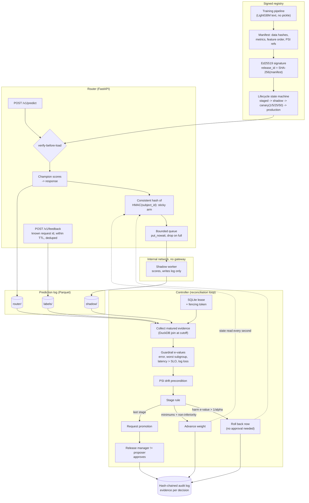

# progressive-model-delivery

Moves an ML model through shadow, canary and production stages with a reconciliation controller
whose statistics stay valid while someone watches every pass. Guardrails are e-values and mixture
SPRTs, so the controller may look at the data after every batch of requests and still keep its
false-decision budget. Harm rolls the challenger back automatically; promotion to production needs
a human who is not the person who proposed it.

No LLM anywhere: this is a deterministic release system whose error rates are measured, not
asserted.

## The problem

Model rollouts tend to be all-or-nothing, or they are judged by refreshing an A/B dashboard until
something looks significant. That habit is not a rounding error. In the A/A study below --
champion and challenger literally identical -- a two-proportion z-test re-read at every
reconciliation pass reaches "significance" and acts on it in **36.7%** of rollouts at a nominal 5%
level. The same test looked at once, at the horizon, lands at 5.1%. The inflation is the peeking,
not the test.

Three more things go wrong in practice, and each one gets a mechanism here rather than a mention:

- **Shadow deployments leak.** A challenger scoring live traffic shares the CPU, the event loop
  and often the credentials of the model answering the customer. Here the shadow hop is a bounded
  drop-on-overflow queue to a separate container on a network with no gateway.
- **Labels arrive late.** Churn labels mature over hours. A rollout judged on the requests whose
  labels happen to have landed is judged on a biased sample, so the controller only ever reads
  requests whose maturation window has closed.
- **A model can be worse for one group and fine overall.** `subgroup_worse` in the demo is 2pp
  worse for one region and within noise globally. The worst-subgroup guardrail catches it during
  the shadow stage, before a single customer is served by it, with Bonferroni-corrected thresholds
  over the subgroups.

## Architecture



Five pieces, each with one job:

**Registry** (`registry/`). A release is a manifest -- dataset digests, training run manifest,
metrics, feature order, PSI references, model card digest -- whose SHA-256 is the release id, with
an Ed25519 signature over exactly those bytes. Artifacts are LightGBM text; the repo has no pickle
path and a test enforces that. `load_verified` checks the file name against the manifest hash, the
signature against a trust store of public keys, every blob against its content address, that the
artifact looks like LightGBM text, and that the parsed booster's feature names equal the manifest's
order -- in that sequence, before the model is used. The lifecycle is a state machine where each
stage is its own type exposing only its legal transitions, so `Staged().promote()` is a type error,
and canary weights are an enumeration, so a 37% canary cannot be constructed.

**Router** (`serving/`). Verifies before loading, answers from the champion, and only then offers
the request to the shadow path. Arm assignment is `SHA-256(rollout_salt || HMAC(secret,
subject_id)) mod 10000 < weight_bp`: sticky as the weight rises, and re-drawn per rollout so the
same customers are not always the test group. `/v1/feedback` accepts a label only for a request id
the router actually issued, only inside the maturation window, and only once.

**Shadow path.** `offer()` is a non-blocking `put_nowait` on a bounded queue; a full queue drops
and counts. A pool of tasks posts jobs to the shadow worker with a hard timeout. In compose the
worker is a separate container on a network declared `internal: true`, so it has no route off that
bridge and holds no credentials for anything with a side effect.

**Evidence** (`control/evidence.py`). One DuckDB query joins the router log, the shadow log and the
labels at a cutoff, keeping only requests whose label window has closed, deduplicating labels, and
reducing everything to per-stage sufficient statistics (2x2 tables per subgroup, per-arm counts,
and count/sum/sum-of-squares of log loss).

**Controller** (`control/`). One pass: take or renew the lease, read the signature-verified
champion and challenger, collect evidence, evaluate every guardrail, apply the stage rule, and
commit the decision with its evidence in a single transaction guarded by the lease's fencing token
and the rollout's revision. A pass is a pure function of state, logs and clock, so running it
twice changes nothing the second time and a replay reproduces the same audit hashes.

### Why the statistics hold up under peeking

Both rollout designs reduce the two-model comparison to one Bernoulli parameter with a known null,
so nothing has to be estimated as a nuisance:

| | shadow stage (paired) | canary stage (weight `w`) |
|---|---|---|
| error, latency > SLO | discordant pairs, `pi0 = 1/2` (sequential McNemar) | events by arm, `pi0 = w r / (w r + 1 - w)` |
| log loss | paired mSPRT on loss differences | two-sample mSPRT, Welch variance |

The canary null holds only if the arm indicator is an independent draw per observation, and the
router draws it once per *subject* so that assignment is sticky. Evidence therefore counts subjects,
not requests: each subject contributes its first matured observation to a stage. Scoring every
request instead inflates the A/A false-rollback rate to about 8% at five requests per customer,
which the validity benchmark below measures on purpose.

For `H0: pi <= pi0` the e-value mixes the likelihood ratio over a Beta prior truncated above
`pi0`. Each component is a supermartingale under every null in the composite, so the mixture is an
e-process and Ville's inequality gives `P(exists t: E_t >= 1/alpha) <= alpha` -- for any stopping
rule, including "whenever the operator refreshes" (Robbins 1970; Howard, Ramdas, McAuliffe and
Sekhon 2021). Mean differences use Robbins' normal mixture (Johari, Koomen, Pekelis and Walsh
2017) with running variances, which makes that guarantee asymptotic (Waudby-Smith, Arbour, Sinha,
Kennedy and Ramdas 2024); a 200-sample burn-in per arm covers the skew of early log-loss means.
Stages use disjoint requests, so per-stage e-values multiply. `alpha_rollback` is split
Bonferroni-style over all harm tests including every subgroup; promotion is an intersection-union
test at `alpha_promotion`.

The same `evaluate()` and `decide()` functions run for one rollout and, with a leading batch axis,
for thousands in the study below. The measured error rates are the shipping code's error rates,
not a re-implementation's.

## Quickstart

```bash
uv sync
uv run python tasks.py demo      # the whole thing, offline, ~2 min
uv run python tasks.py check     # lint, typecheck, test, audit, baseline
uv run python tasks.py bench     # the four benchmarks with regression thresholds
```

`demo` trains three models on synthetic data, signs and publishes them, and runs two complete
rollouts against a real router, a real shadow worker and the real controller -- nothing mocked, no
network, no API key. It prints a machine-readable record of what happened:

```
rollback_scenario:  challenger=subgroup_worse  outcome=rolled_back  stage_reached=0 (shadow)
                    decision_reason="guardrail breach: worst_subgroup_error[south]"
                    harm_tests_crossed=[worst_subgroup_error[south]: log_e 5.83 > 5.63]
                    challenger_served_requests=0
                    requests=4750  labels_accepted=4233  labels_refused_after_window=134
promotion_scenario: challenger=better  outcome=promotion_requested -> status=promoted
                    canary_weights=[1.0, 5.0, 25.0, 50.0]  challenger_served_requests=1071
                    non_inferiority_crossed=[error_rate: 7.26 > 3.69, log_loss: 6.71 > 3.69]
                    refused_approvals=["forbidden: the proposer cannot approve their own rollout"]
                    approved_by=ravi
audit:              entries=10  verified=true  simulated_hours=1.73
```

The subgroup-regressed challenger is caught during shadow, so it never serves a customer. The
better one walks every stage, proves non-inferiority on served traffic, and then stops and waits:
the controller asks for promotion, the proposer is refused, and a release manager grants it.

Outcomes are deterministic and the test suite asserts them. The **canary** numbers -- served
requests and the exact e-values at promotion -- move by a few percent between runs, because each
rollout draws a fresh random assignment salt on purpose, so the same customers are not always the
test group. The rollback scenario is bit-identical run to run: it finishes during the shadow stage,
where both models score every request and there is no partition to draw.

To run the real topology (router and shadow worker in separate containers, the worker with no
egress):

```bash
docker compose run --rm bootstrap        # train + sign; prints the public key and release ids
export APP_TRUSTED_SIGNING_KEYS=<public_key_b64>
docker compose up router shadow controller
scripts/compose_e2e.sh                   # the end-to-end assertions CI runs
```

## Results

All numbers below are the output of `bench/` scripts on this machine: Windows 10, 6 CPUs,
Intel i7-8700 class, CPU-only, Python 3.12.14, NumPy 2.5.3. Every table is pasted from a real run;
the command is above it. `bench/thresholds.json` holds the regression gates CI enforces.

### Validity under continuous monitoring

`uv run python bench/bench_validity.py --check` (about 2 min wall)

```
2000 rollouts x up to 90 looks (2000 requests each) in 97.2 s
| measurement | rate | 95% CI | budget |
|---|---|---|---|
| A/A false rollback (anytime-valid) | 0.0060 | [0.0031, 0.0105] | alpha_rollback = 0.025 |
| A/A decision by repeated z-test (peeking) | 0.3665 | - | nominal alpha = 0.05 |
| A/A decision by the same z-test, one look | 0.0510 | - | nominal alpha = 0.05 |
| promotion of a challenger past the margin | 0.0000 | [0.0000, 0.0018] | alpha_promotion = 0.025 |
| rollback of a challenger past the margin | 1.0000 | - | power, not error |
| A/A false rollback, 5 requests per subject, scored per request | 0.0830 | [0.0667, 0.1018] | alpha_rollback = 0.025 (breached) |
| A/A false rollback, 5 requests per subject, scored per subject | 0.0090 | [0.0041, 0.0170] | alpha_rollback = 0.025 |
  sticky assignment: the arm is drawn once per subject, so a customer's 5 requests are one observation. Scoring them as 5 inflates the rate past the budget; scoring one per subject holds the budget and costs evidence -- 0.039 of those rollouts reached promotion within 90 looks (952 were still open).
  coupling_0.5: A/A false rollback 0.0040 over 500 rollouts
  coupling_0.95: A/A false rollback 0.0060 over 500 rollouts

time-uniform coverage over 1000 paths x 1500 steps (alpha = 0.05):
| confidence sequence | miss rate |
|---|---|
| beta binomial p0.05 | 0.0270 |
| beta binomial p0.2 | 0.0280 |
| beta binomial p0.5 | 0.0320 |
| normal mixture | 0.0350 |
all validity measurements within thresholds
```

Identical models, monitored at every one of up to 90 reconciliation passes: 0.6% of rollouts ever
roll back **on a guardrail e-value**, against a 2.5% budget. (The label-free score-PSI guard can also
force a rollback and carries no error guarantee; this study runs the e-value guardrails only, which
`sim/study.py` states.) The same arrival process judged by a repeatedly-read z-test acts wrongly in
36.7%. The e-values are conservative -- that conservatism is what the next table costs.

The last two rows are about the assignment that ships. Because the arm comes from a consistent hash
of the subject, a customer who sends five requests is *one* draw of the arm indicator: scoring all
five as independent evidence puts the false-rollback rate at 8.3%, three times the budget. The
evidence reader counts one observation per subject per stage, which holds the budget at 0.9% and
costs evidence instead -- only 3.9% of those rollouts reached promotion inside 90 looks, because
five-requests-per-customer traffic carries about a fifth of the evidence it appears to.

### Power and exposure

`uv run python bench/bench_power.py --check` (about 45 s wall)

```
400 rollouts per scenario, up to 60 looks of 2000 requests, in 39.6 s
| scenario | detected | median looks | median exposure | canary-only exposure | fixed horizon (80%) |
|---|---|---|---|---|---|
| error_+1pp | 1.000 | 2 | 0 | 12571 | 51,165 |
| error_+2pp | 1.000 | 1 | 0 | 3652 | 13,019 |
| error_+5pp | 1.000 | 1 | 0 | 1106 | 2,188 |
| latency_+20ms | 1.000 | 1 | 0 | 19 | - |
| subgroup_south_+5pp | 0.960 | 5 | 630 | 13414 | 18,233 |
| subgroup_worse | 0.875 | 8 | 1652 | 12728 | 21,166 |
| feature_order_bug | 1.000 | 1 | 0 | 628 | 6,716 |
measured_better: promoted 1.000, rolled back 0.000, median looks to promotion 15.0
```

`median exposure` is the number of *customer* requests the challenger answered before it was rolled
back: zero for every globally-worse regression, because those are caught during the shadow stage.
Subgroup-only regressions need more evidence and cost some exposure. `canary-only exposure` is the
counterfactual -- what a rollout that skipped shadow and went straight to a 1% canary would have
exposed. `fixed horizon (80%)` is the sample size a fixed-horizon two-proportion test would need
for 80% power at the same effect, for scale; the sequential test stops earlier on large effects and
pays for it on `subgroup_worse`, where it detects 87.5% rather than 100%.

### The cost of the shadow path

`uv run python bench/bench_serving.py --check` (about 27 s wall)

```
POST /v1/predict, 2000 requests per mode (in-process test client)
| mode | p50 (us) | p95 (us) | p99 (us) | added p99 (ms) | failed | shadow jobs |
|---|---|---|---|---|---|---|
| champion_only | 1490.8 | 2181.1 | 2571.4 | +0.0000 | 0 | - |
| shadow_in_process | 3889.8 | 5112.0 | 5777.6 | +3.2062 | 0 | delivered=2200, dropped=0, enqueued=2200 |
| shadow_hanging | 1939.4 | 2815.2 | 4686.5 | +2.1151 | 0 | delivered=0, dropped=1640, enqueued=560, failed=44 |

| request-path operation | runs | p50 (us) | p99 (us) |
|---|---|---|---|
| forwarder_offer_queued | 20000 | 1.6 | 1.9 |
| forwarder_offer_dropped | 20000 | 1.2 | 1.5 |
```

The only shadow work on the customer's request path is the enqueue: **p99 1.9 us**, and 1.5 us on
the drop path. That is the number CI gates (50 us), and it is stable across runs.

A shadow worker that never answers costs **0 failed requests** and 1,640 dropped jobs out of 2,200.
The champion's own percentiles move a little -- across four runs of this table, `shadow_hanging`
added 0.4-0.6 ms at p50 and 0.4-2.1 ms at p99. That spread is the timeout path competing for the
same event loop on a 6-CPU Windows box, not a trend; the gates are set at 3 ms (p50) and 10 ms (p99)
for that reason. The claim this table supports is the one about failed requests, which is exact.

`shadow_in_process` is reported and deliberately *not* claimed as the production cost. It mounts
the shadow worker on the router's own event loop, so its signature verification, LightGBM scoring
and Parquet writing compete with the request being timed -- +3.3 ms p99 is the cost of sharing one
process, not the cost of forwarding. The deployed topology gives the worker its own container, and
`scripts/compose_e2e.sh` is what checks that boundary.

### Hot paths

`uv run python bench/bench_baseline.py --check` (about 7 s wall)

```
| benchmark | runs | p50 (us) | p95 (us) |
|---|---|---|---|
| subject_hash | 50000 | 5.1 | 5.8 |
| assignment | 50000 | 2.0 | 2.3 |
| beta_mixture_e_value | 5000 | 76.5 | 166.0 |
| paired_msprt | 5000 | 40.1 | 69.7 |
| reconcile_decision_5_stages | 300 | 5864.5 | 15373.9 |
| audit_append_one_entry | 200 | 7207.7 | 14289.2 |
| audit_verify_1000_entries | 10 | 30080.3 | 44897.4 |
| psi_10k_vs_10k | 200 | 255.2 | 517.1 |
| drift_check_10k_vs_10k | 30 | 2602.1 | 4918.6 |
```

A whole reconciliation decision -- every guardrail over five stages and every subgroup -- costs
about 6 ms at p50, so the loop can run every few seconds without thinking about it. The p95 on this
box is noisy (4.6-15 ms across runs, hence the 40 ms gate); nothing here depends on the tail.

### Tests

512 tests, over 97% line-and-branch coverage (`uv run python tasks.py test`, floor 85%). 27 of them
are hypothesis properties: that the e-value mixture is a supermartingale under every null rate,
that harm evidence is monotone in challenger-only failures, that random action sequences on the
lifecycle only ever traverse legal edges, that assignment is sticky as the weight rises and splits
within binomial bounds, and that confidence sequences keep their coverage checked at every step
rather than at a chosen horizon.

## Security

Every control below is implemented and tested; [CLAIMS.md](CLAIMS.md) maps each one to the test
that holds it up, and [docs/THREAT_MODEL.md](docs/THREAT_MODEL.md) works through the attacker's
side.

- **Model supply chain.** Ed25519 signature over the manifest bytes, verified against a trust
  store before load. A tampered artifact, a tampered manifest, a valid signature by an untrusted
  key, a swapped file name and a feature order that disagrees with the booster are all refused
  with distinct reasons. LightGBM text only; a test fails the build on any pickle-family import.
- **Separation of duties.** A deployer proposes, a release manager who is not the proposer
  approves the final promotion, and forcing a stage past its statistical gate needs two distinct
  release managers. Automatic rollback needs nobody. Every request, approval and execution is an
  entry in a hash-chained log that carries the evidence it was based on. Those rules cover
  *decisions*, not the policy a rollout is judged against: a deployer proposes the spec alone, so
  the control plane keeps configured floors under it -- `APP_MAX_SPEC_ALPHA`,
  `APP_REQUIRED_GUARDRAILS`, and a maturation window at least as long as the router's label TTL --
  and review covers what those floors do not.
- **Shadow isolation.** No egress, no side-effect credentials, bounded queue, hard timeout,
  drop-on-overflow. Fault injection proves a crashing, hanging or erroring challenger costs
  dropped shadow jobs and nothing else.
- **Feedback integrity.** Labels only for request ids the router issued, only within the
  maturation window, deduplicated, and separately rate limited -- otherwise anyone who can reach
  `/v1/feedback` can poison the metric that decides the rollout.
- **Request surface.** API-key auth (digests only, never raw keys in config), pandera and
  pydantic contracts, per-client rate limits, body-size limits, security headers, strict CORS, and
  errors that do not leak internals.
- **Privacy.** Subject ids are HMAC-hashed before they reach assignment or any log; logs go
  through a redacting processor; secrets are `SecretStr` from the environment and only
  `.env.example` is committed.

## Non-goals

Cut deliberately, and named here rather than implied:

- **One router instance.** The prediction log, the sticky assignment and the controller lease are
  all designed for horizontal scale-out, but nothing here runs or tests several routers at once.
  `docs/adr/0003-single-router-and-the-multi-instance-design.md` records what would change.
- **No real dataset or real model quality.** The demo models are LightGBM on synthetic churn data,
  built so that specific failure modes exist to be caught. Nothing here says anything about
  churn prediction; see [MODEL_CARD.md](MODEL_CARD.md).
- **No live A/B analytics.** The controller decides one question -- ship or do not ship -- against
  a fixed policy. It is not an experimentation platform and reports no lift estimates.
- **No delayed-label imputation.** A label that misses its window is a lost label, counted and
  ignored, not modelled.
- **Time-to-promotion is not optimised.** The stage schedule is a policy input, not something the
  controller searches over. No always-valid optimal stopping, no bandit allocation.
- **`shadow_in_process` p99 is not a production number.** See the serving bench above.
- **The compose end-to-end script runs in CI only.** It needs docker; it is not part of
  `tasks.py check`.
- **No secrets management, no KMS.** The signing key is a file and the trust store is an
  environment variable. A real deployment would keep the private key in an HSM or KMS.

## Layout

```
src/progressive_model_delivery/
  registry/     signing, signed release store, lifecycle state machine
  serving/      router, assignment, bounded forwarder, shadow worker, prediction log
  stats/        e-values, mixture SPRT, confidence sequences, power calculator
  control/      rollout spec, evidence reader, guardrails, controller, RBAC, audit, control API
  models/       synthetic data, features, training, scoring, demo pipeline
  sim/          traffic and delayed-label simulator, scenarios, vectorized study, peeking baseline
  ml/           data contract, run manifest, content-addressed registry, drift, safe serialization
  core/         settings, redacting logs, tracing, metrics, hardened app factory, health probes
bench/          baseline, validity, power and serving benchmarks with thresholds
docs/           threat model, rollout policy, rollback runbook, ADRs
```

Further reading: [docs/ROLLOUT_POLICY.md](docs/ROLLOUT_POLICY.md) for what the guarantees do and do
not say, [docs/RUNBOOK_ROLLBACK.md](docs/RUNBOOK_ROLLBACK.md) for the on-call path, and
[docs/adr/](docs/adr/) for the design trade-offs.

## License

MIT. See [LICENSE](LICENSE).
