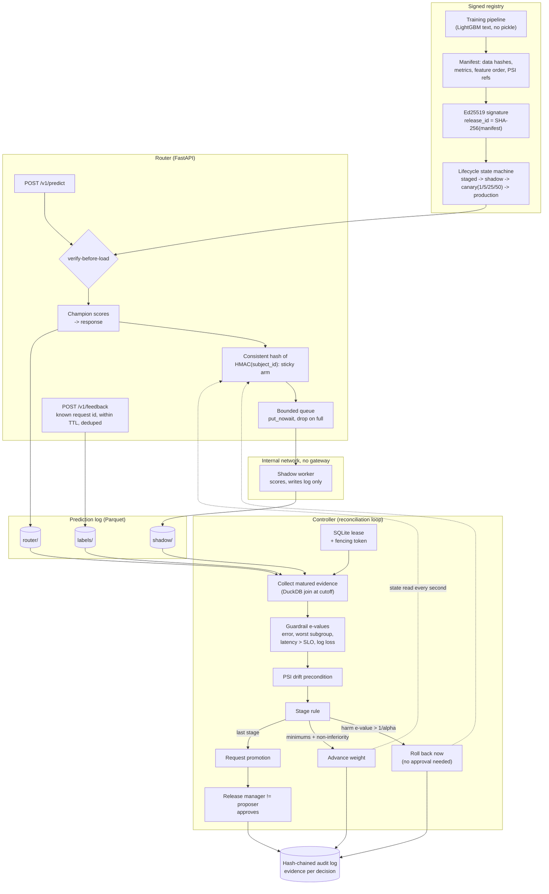

# progressive-model-delivery

A release system for machine-learning models. It rehearses a new model on a copy of live traffic,
then gives it a small share of real traffic, checks for harm after every batch of requests, and
takes it back out by itself before most customers ever meet it.

## The problem

Think of the model that decides which customers are about to leave, and therefore who gets a
retention offer. A new version of that model looks better in the training report, so it ships. It
is 2 percentage points worse for customers in one region and fine everywhere else, so the overall
average hides it. The true outcome -- did the customer actually leave? -- only arrives hours later,
so nobody can see the damage on the day of the release. By the time the weekly review notices, a
region has spent days being handled by the worse model.

The usual answer is an A/B dashboard that somebody refreshes until a number looks significant. That
habit is not a rounding error, and this repository measures it. In the A/A study below -- the live
model and the candidate *literally identical*, so there is nothing to find -- a two-proportion
z-test re-read at every pass reaches "significance" and acts on it in **36.7%** of rollouts at a
nominal 5% level. The same test looked at once, at the end, lands at 5.1%. So a release process
built that way throws away roughly one good model in three, and every one of those rollbacks
arrives with a p-value attached and looks like a real finding. Teams stop believing the gate, and then they stop using it.

This repository is the other half of that: a controller that is *designed* to be watched
continuously. It may re-read its evidence after every batch of requests and still keep its
false-decision budget, so "check constantly" and "be right" stop being in tension. Harm rolls the
new model back with no human in the loop. Going to full production needs a human, and not the
person who proposed the release.

No LLM anywhere: this is a deterministic release system whose error rates are measured, not
asserted.

## What this does

- **Rehearses before it risks anything.** In the shadow stage the new model scores the same
  requests as the live one, but its answers go to a log, never to a customer. Globally worse models
  are caught here, at zero customer exposure.
- **Then releases in small, sticky steps** -- 1%, 5%, 25%, 50% of traffic -- and a given customer
  always gets the same model, so nobody sees one model on Monday and another on Tuesday.
- **Watches three kinds of harm after every batch:** more mistakes overall, more mistakes for any
  one group of customers, and answers slower than the promised limit. Watching often does not make
  these checks lie; the statistics are built for it, and the rate at which they cry wolf is measured
  below.
- **Waits for the truth to arrive.** Outcomes ("labels" -- the real answer, known later) turn up
  hours after the prediction, and they arrive faster for some outcomes than others. The controller
  only judges requests whose waiting window has closed, so it never compares two models on a
  lopsided sample.
- **Takes the model out by itself, and explains why.** A rollback needs nobody's approval; a
  promotion needs a release manager who is not the proposer. Every decision, and the evidence it
  rested on, is appended to a tamper-evident log.

## Architecture



### How one request flows through it

1. **A request arrives** at the router with an API key and a subject id (the customer it is about).
   The key, the rate limit, the body size and the field contracts are all checked before anything
   is scored.
2. **The champion answers it.** The champion is the model currently in production. Its signature
   was verified before it was ever loaded. The new model has not run yet, so nothing it does can
   delay this response.
3. **If a canary stage is live, the router works out which model this subject belongs to** by
   hashing the subject id (already HMAC-hashed, so the raw id never reaches assignment or the log)
   together with the rollout's salt. The same subject lands in the same arm every time, including
   after the weight rises from 1% to 50%.
4. **Only after the answer has gone out** does the router offer the request to the shadow path: one
   non-blocking enqueue on a bounded queue, measured at p99 1.9 microseconds. A full queue drops
   the job and counts it. It is never awaited, never retried.
5. **A pool of background tasks posts queued jobs to the shadow worker**, which runs in its own
   container on a network with no gateway. It authenticates the caller before it parses the body,
   verifies the model's signature before it scores, and writes only its own prediction segments. It
   cannot reach the internet, the control database or the router's log.
6. **Prediction, arm and model version go to a Parquet log.** Hours later the real outcome arrives
   at `/v1/feedback`. The router accepts it only for a request id it actually issued, only inside
   the maturation window, and only once.
7. **Every few seconds the controller takes its lease and reads the evidence**: one DuckDB query
   joins requests, shadow predictions and labels at a cutoff that excludes anything whose label
   window has not closed, and reduces the rest to per-stage counts, per subgroup, one observation
   per subject.
8. **It updates one statistic per guardrail and compares it to a threshold.** Strong evidence of
   harm means roll back now, with no human involved. Enough evidence of "no worse" plus the stage's
   sample and duration minimums means advance to the next weight. At the last stage it asks a
   release manager for the promotion.
9. **The decision, its evidence and the spec hash are appended to a hash-chained log** in the same
   transaction that changes the state, so the record and the state cannot disagree.

## Results

Every number here is the output of a script in `bench/` on one machine: Windows 10, 6 CPUs, Intel
i7-8700 class, CPU-only, Python 3.12.14, NumPy 2.5.3. Wall times were measured with other work on
the box, so they are upper bounds. `bench/thresholds.json` holds the regression gates CI enforces,
and [CLAIMS.md](CLAIMS.md) maps every claim to the test or script behind it.

| What was measured | Result | What it means for you | Command |
|---|---|---|---|
| False rollback with two identical models, watched at every pass | **0.6%** of rollouts, 95% CI [0.31%, 1.05%] | Run 2,000 releases of a model that is exactly as good as the one it replaces, and check up to 90 times each: 6 in 1,000 get pulled for no reason. The budget was 2.5%. | `uv run python bench/bench_validity.py --check` |
| The same data judged by a repeatedly-read z-test | **36.7%** | The dashboard-refreshing habit this replaces would pull more than one healthy model in three. | same |
| The same z-test, read once at the end | 5.1% | That test is fine when used as intended. The inflation above is the peeking, not the test. | same |
| Customer requests served by a globally worse model before rollback | **0** (median) | For +1pp, +2pp and +5pp error regressions, a +20 ms latency regression and a feature-order bug: caught during the rehearsal stage, so no customer was ever answered by them. | `uv run python bench/bench_power.py --check` |
| A model that is worse for one subgroup only (2pp worse for 12% of traffic) | detected in **87.5%** of rollouts, median 1,652 customer requests served first | The hard case, stated honestly: usually caught, and it costs real exposure. Without the rehearsal stage the same regression costs a median 12,728 requests. | same |
| A genuinely better model | promoted in **100%** of 400 rollouts, median 15 passes | The system is not simply conservative; a better model gets through, after a human approves it. | same |
| Shadow work on the customer's request path | p99 **1.9 microseconds** | The slowest 1 in 100 requests spent under two thousandths of a millisecond on the shadow hop. CI fails the build above 50 microseconds. | `uv run python bench/bench_serving.py --check` |
| Customer requests failed while the shadow worker hangs forever | **0** of 2,000 | A new model that stops answering costs dropped shadow jobs and nothing else. | same |
| One complete reconciliation decision (5 stages, every guardrail, every subgroup) | p50 **4.4 ms** | The controller can re-decide every few seconds without the decision itself being the cost. | `uv run python bench/bench_baseline.py --check` |
| Test suite | 544 tests, **97.5%** line-and-branch coverage | 27 of them are property tests over generated inputs, not fixed examples. | `uv run python tasks.py test` |

The rest of this section is the raw output behind those rows.

### Validity under continuous monitoring

`uv run python bench/bench_validity.py --check` (about 2 min wall)

```
2000 rollouts x up to 90 looks (2000 requests each) in 99.3 s
| measurement | rate | 95% CI | budget |
|---|---|---|---|
| A/A false rollback (anytime-valid) | 0.0060 | [0.0031, 0.0105] | alpha_rollback = 0.025 |
| A/A decision by repeated z-test (peeking) | 0.3665 | - | nominal alpha = 0.05 |
| A/A decision by the same z-test, one look | 0.0510 | - | nominal alpha = 0.05 |
| promotion of a challenger past the margin | 0.0000 | [0.0000, 0.0018] | alpha_promotion = 0.025 |
| rollback of a challenger past the margin | 1.0000 | - | power, not error |
| A/A false rollback, 5 requests per subject, scored per request | 0.0830 | [0.0667, 0.1018] | alpha_rollback = 0.025 (breached) |
| A/A false rollback, 5 requests per subject, scored per subject | 0.0090 | [0.0041, 0.0170] | alpha_rollback = 0.025 |
  sticky assignment: the arm is drawn once per subject, so a customer's 5 requests are one observation. Scoring them as 5 inflates the rate past the budget; scoring one per subject holds the budget and costs evidence -- 0.039 of those rollouts reached promotion within 90 looks (952 were still open).
  coupling_0.5: A/A false rollback 0.0040 over 500 rollouts
  coupling_0.95: A/A false rollback 0.0060 over 500 rollouts

time-uniform coverage over 1000 paths x 1500 steps (alpha = 0.05):
| confidence sequence | miss rate |
|---|---|
| beta binomial p0.05 | 0.0270 |
| beta binomial p0.2 | 0.0280 |
| beta binomial p0.5 | 0.0320 |
| normal mixture | 0.0350 |
all validity measurements within thresholds
```

Identical models, monitored at every one of up to 90 reconciliation passes: 0.6% of rollouts ever
roll back **on a guardrail e-value**, against a 2.5% budget. (The label-free score-PSI guard can
also force a rollback and carries no error guarantee; this study runs the e-value guardrails only,
which `sim/study.py` states.) The e-values are conservative -- that conservatism is what the next
table costs.

The last two rows are about the assignment that ships, and they are the most instructive failure in
the repo. Because the arm comes from a consistent hash of the subject, a customer who sends five
requests is *one* draw of the arm indicator, not five. Counting all five as independent evidence
puts the false-rollback rate at 8.3% -- three times the budget, from an accounting mistake rather
than a statistical one. The evidence reader counts one observation per subject per stage, which
holds the budget at 0.9% and pays for it in evidence: only 3.9% of those rollouts reached promotion
inside 90 looks, because five-requests-per-customer traffic carries about a fifth of the evidence it
appears to.

### Power and exposure

`uv run python bench/bench_power.py --check` (about 45 s wall)

```
400 rollouts per scenario, up to 60 looks of 2000 requests, in 37.2 s
| scenario | detected | median looks | median exposure | canary-only exposure | fixed horizon (80%) |
|---|---|---|---|---|---|
| error_+1pp | 1.000 | 2 | 0 | 12571 | 51,165 |
| error_+2pp | 1.000 | 1 | 0 | 3652 | 13,019 |
| error_+5pp | 1.000 | 1 | 0 | 1106 | 2,188 |
| latency_+20ms | 1.000 | 1 | 0 | 19 | - |
| subgroup_south_+5pp | 0.960 | 5 | 630 | 13414 | 18,233 |
| subgroup_worse | 0.875 | 8 | 1652 | 12728 | 21,166 |
| feature_order_bug | 1.000 | 1 | 0 | 628 | 6,716 |
measured_better: promoted 1.000, rolled back 0.000, median looks to promotion 15.0
```

Read `median exposure` as "how many customer requests the bad model answered before it was pulled":
zero for every globally-worse regression, because the rehearsal stage sees those before any customer
does. `canary-only exposure` is the counterfactual -- what a rollout that skipped the rehearsal and
went straight to a 1% canary would have exposed, which is where the shadow stage earns its
complexity. `fixed horizon (80%)` is the sample size a classical two-proportion test would need for
80% power at the same effect, for scale; the sequential test stops far earlier on large effects and
pays for it on `subgroup_worse`, where it detects 87.5% rather than 100%.

### The cost of the shadow path

`uv run python bench/bench_serving.py --check` (about 45 s wall)

```
POST /v1/predict, 2000 requests per mode (in-process test client)
| mode | p50 (us) | p95 (us) | p99 (us) | added p99 (ms) | failed | shadow jobs |
|---|---|---|---|---|---|---|
| champion_only | 1794.6 | 3012.1 | 3642.1 | +0.0000 | 0 | - |
| shadow_stub | 3517.0 | 4998.2 | 5792.4 | +2.1503 | 0 | delivered=2200, dropped=0, enqueued=2200 |
| shadow_in_process | 4204.4 | 6001.3 | 6760.0 | +3.1179 | 0 | delivered=2200, dropped=0, enqueued=2200 |
| shadow_hanging | 2126.7 | 3749.4 | 4960.4 | +1.3183 | 0 | delivered=0, dropped=1632, enqueued=568, failed=52 |

| request-path operation | runs | p50 (us) | p99 (us) |
|---|---|---|---|
| forwarder_offer_queued | 20000 | 1.6 | 1.9 |
| forwarder_offer_dropped | 20000 | 1.1 | 1.3 |
| stub_shadow_round_trip | 2000 | 1127.5 | 2740.3 |

POST /v1/predict, champion only, N requests in flight at once (scoring off the loop)
| clients | runs | p50 (us) | p99 (us) | throughput (req/s) | failed |
|---|---|---|---|---|---|
| 1 | 500 | 2274.3 | 3875.4 | 400.8 | 0 |
| 8 | 496 | 18901.7 | 35530.8 | 412.3 | 0 |
```

The only shadow work on the customer's request path is the enqueue: **p99 1.9 us**, and 1.3 us on
the drop path. That is the number CI gates (50 us), and it is stable across runs.

A shadow worker that never answers costs **0 failed requests** and drops 1,632 of 2,200 jobs. The
champion's own percentiles move a little -- in this run `shadow_hanging` added 0.33 ms at p50 and
1.32 ms at p99, which is the timeout path competing for the same event loop on a 6-CPU Windows box.
The gates sit at 1 ms (p50) and 5 ms (p99). The claim this table supports is the one about failed
requests, which is exact.

`shadow_stub` is the forwarding cost with the worker's compute taken out: the real `ShadowForwarder`
and the real HTTP sender against an ASGI app that answers 202 and does nothing else. It adds p50
1.72 ms and p99 2.15 ms here -- and the `stub_shadow_round_trip` row says why: one in-process
`httpx` request to that do-nothing app costs p50 1.13 ms by itself. That is this benchmark's shape
rather than the forwarder's cost, and it is why the "shadow forwarding adds < 1 ms to champion p99"
goal is not measurable here (see Non-goals): a separate container is not an ASGI transport in the
same process. What CI gates is the request path (50 us) and this mode at the measured p50 3 ms /
p99 4 ms.

`shadow_in_process` is reported and deliberately *not* claimed as the production cost. It mounts the
shadow worker on the router's own event loop, so its signature verification, LightGBM scoring and
Parquet writing compete with the request being timed -- +3.1 ms p99 is the cost of sharing one
process, not the cost of forwarding; the gap to `shadow_stub` is roughly what the worker's own
compute costs. The deployed topology gives the worker its own container, and
`scripts/compose_e2e.sh` is what checks that boundary.

Scoring runs in a worker thread (`asyncio.to_thread`), not on the event loop, so a blocking LightGBM
call cannot stall the refresh loop, the flush loop or the forwarder's delivery tasks. The
concurrency rows show what that does and does not buy on this box: throughput is flat within its
noise while p99 grows with the queue, because single-row LightGBM scoring holds the GIL.
Concurrency here buys a shorter loop, not parallel scoring.

### Hot paths

`uv run python bench/bench_baseline.py --check` (about 7 s wall)

```
| benchmark | runs | p50 (us) | p95 (us) |
|---|---|---|---|
| redact_text_1kb | 2000 | 339.0 | 446.8 |
| rate_limiter_check | 20000 | 1.8 | 1.9 |
| subject_hash | 50000 | 5.1 | 5.5 |
| assignment | 50000 | 2.0 | 2.1 |
| beta_mixture_e_value | 5000 | 75.6 | 94.6 |
| paired_msprt | 5000 | 40.5 | 49.9 |
| reconcile_decision_5_stages | 300 | 4365.8 | 5912.5 |
| audit_append_one_entry | 200 | 6727.6 | 8327.6 |
| audit_verify_1000_entries | 10 | 27938.8 | 35195.3 |
| psi_10k_vs_10k | 200 | 245.6 | 288.8 |
| drift_check_10k_vs_10k | 30 | 2620.8 | 3319.5 |
```

A whole reconciliation decision -- every guardrail over five stages and every subgroup -- costs
4-6 ms at p50 across runs, so the loop can run every few seconds without thinking about it. The p95
on this box is noisy (hence the 40 ms gate); nothing here depends on the tail.

### Tests

544 tests, 97.5% line-and-branch coverage (`uv run python tasks.py test`, floor 85%; a few minutes
on this box). 27 of them are hypothesis properties: that the e-value mixture is a supermartingale
under every null rate, that harm evidence is monotone in challenger-only failures, that random
action sequences on the lifecycle only ever traverse legal edges, that assignment is sticky as the
weight rises and splits within binomial bounds, and that confidence sequences keep their coverage
checked at every step rather than at a chosen horizon.

## How it works

Five pieces, each with one job.

**Registry** (`registry/`). A release is a manifest -- dataset digests, training run manifest,
metrics, feature order, PSI references, model card digest -- whose SHA-256 is the release id, with
an Ed25519 signature over exactly those bytes. Artifacts are LightGBM text; the repo has no pickle
path and a test enforces that. `load_verified` checks the file name against the manifest hash, the
signature against a trust store of public keys, every blob against its content address, that the
artifact looks like LightGBM text, and that the parsed booster's feature names equal the manifest's
order -- in that sequence, before the model is used. The lifecycle is a state machine where each
stage is its own type exposing only its legal transitions, so `Staged().promote()` is a type error,
and canary weights are an enumeration, so a 37% canary cannot be constructed.

**Router** (`serving/`). Verifies before loading, answers from the champion, and only then offers
the request to the shadow path. Arm assignment is `SHA-256(rollout_salt || HMAC(secret,
subject_id)) mod 10000 < weight_bp`: sticky as the weight rises, and re-drawn per rollout so the
same customers are not always the test group. `/v1/feedback` accepts a label only for a request id
the router actually issued, only inside the maturation window, and only once.

**Shadow path.** `offer()` is a non-blocking `put_nowait` on a bounded queue; a full queue drops
and counts. A pool of tasks posts jobs to the shadow worker with a hard timeout. In compose the
worker is a separate container on a network declared `internal: true`, so it has no route off that
bridge and holds no credentials for anything with a side effect; it mounts the shared state volume
read-only and writes only its own prediction segments, so it cannot touch the control database or
the router's log either. Dropping rather than retrying is a statistical decision as much as an
operational one, and
`docs/adr/0005-shadow-traffic-is-dropped-not-queued.md` is the argument: the paired test needs pairs
whose *presence* is independent of the outcome, and a retry queue would bias the sample toward
whatever the shadow worker finds slow.

**Evidence** (`control/evidence.py`). One DuckDB query joins the router log, the shadow log and the
labels at a cutoff, keeping only requests whose label window has closed, deduplicating labels, and
reducing everything to per-stage sufficient statistics (2x2 tables per subgroup, per-arm counts,
and count/sum/sum-of-squares of log loss). Why only matured requests, and why not imputation, is
`docs/adr/0006-matured-cohorts-for-delayed-labels.md`: label delay is correlated with the outcome,
so at any cutoff the labelled subset over-represents whichever class settles faster.

**Controller** (`control/`). One pass: take or renew the lease, read the signature-verified champion
and challenger, collect evidence, evaluate every guardrail, apply the stage rule, and commit the
decision with its evidence in a single transaction guarded by the lease's fencing token and the
rollout's revision. A pass is a pure function of state, logs and clock, so running it twice changes
nothing the second time and a replay reproduces the same audit hashes.

### Why the statistics hold up under peeking

Both rollout designs reduce the two-model comparison to one Bernoulli parameter with a known null,
so nothing has to be estimated as a nuisance:

| | shadow stage (paired) | canary stage (weight `w`) |
|---|---|---|
| error, latency > SLO | discordant pairs, `pi0 = 1/2` (sequential McNemar) | events by arm, `pi0 = w r / (w r + 1 - w)` |
| log loss | paired mSPRT on loss differences | two-sample mSPRT, Welch variance |

The canary null holds only if the arm indicator is an independent draw per observation, and the
router draws it once per *subject* so that assignment is sticky. Evidence therefore counts subjects,
not requests: each subject contributes its first matured observation to a stage. Scoring every
request instead inflates the A/A false-rollback rate to 8.3% at five requests per customer, which
the validity benchmark measures on purpose.

For `H0: pi <= pi0` the e-value mixes the likelihood ratio over a Beta prior truncated above
`pi0`. Each component is a supermartingale under every null in the composite, so the mixture is an
e-process and Ville's inequality gives `P(exists t: E_t >= 1/alpha) <= alpha` -- for any stopping
rule, including "whenever the operator refreshes" (Robbins 1970; Howard, Ramdas, McAuliffe and
Sekhon 2021). Mean differences use Robbins' normal mixture (Johari, Koomen, Pekelis and Walsh
2017) with running variances, which makes that guarantee asymptotic (Waudby-Smith, Arbour, Sinha,
Kennedy and Ramdas 2024); a 200-sample burn-in per arm covers the skew of early log-loss means.
Stages use disjoint requests, so per-stage e-values multiply. `alpha_rollback` is split
Bonferroni-style over all harm tests including every subgroup; promotion is an intersection-union
test at `alpha_promotion`.

The same `evaluate()` and `decide()` functions run for one rollout and, with a leading batch axis,
for thousands in the study above. The measured error rates are the shipping code's error rates, not
a re-implementation's.

### The trade-off, and the obvious alternative

Validity under arbitrary stopping is bought with power, and the bill is in the power table. The
obvious alternative is the classical route: fix the sample size, test once, or use a
group-sequential design with a pre-planned look schedule. Those are more powerful at their own
horizon. They also require knowing in advance how many times you will look, which a reconciliation
loop cannot know -- a stage waits for as many passes as the traffic needs -- and they cannot stop
early on a large regression, which is exactly when stopping early matters most. Here a +5pp error
regression is caught at the first look and a fixed-horizon test sized for 80% power at that effect
would still be collecting its 2,188 samples.

What the choice costs: `subgroup_worse` is detected in 87.5% of rollouts rather than 100%. That is
the honest price, and
`docs/adr/0002-anytime-valid-e-values-instead-of-fixed-horizon-tests.md` argues why it is worth
paying -- a missed subtle regression is caught by the next rollout's evidence, whereas a 36.7%
false-rollback rate makes the whole gate untrustworthy within a week.
`docs/adr/0004-mixture-prior-strength.md` covers where the prior comes from, and
`docs/adr/0003-single-router-and-the-multi-instance-design.md` records what would change with more
than one router.

## Security

The short version: an attacker's two prizes here are **the decision** (get a bad model promoted, or
a good one rolled back) and **the evidence the decision is made from** (poison it and the decision
follows). Every control below is implemented and tested; [CLAIMS.md](CLAIMS.md) maps each one to
the test that holds it up, and [docs/THREAT_MODEL.md](docs/THREAT_MODEL.md) works through the
attacker's side per trust boundary.

- **A model cannot be swapped for another one.** Ed25519 signature over the manifest bytes,
  verified against a trust store before load. A tampered artifact, a tampered manifest, a valid
  signature by an untrusted key, a swapped file name and a feature order that disagrees with the
  booster are all refused with distinct reasons. LightGBM text only; a test fails the build on any
  pickle-family import.
- **One person cannot ship a model alone.** A deployer proposes, a release manager who is not the
  proposer approves the final promotion, and forcing a stage past its statistical gate needs two
  distinct release managers. Automatic rollback needs nobody. Every request, approval and execution
  is an entry in a hash-chained log that carries the evidence it was based on. Those rules cover
  *decisions*, not the policy a rollout is judged against: a deployer proposes the spec alone, so
  the control plane keeps configured floors under it -- `APP_MAX_SPEC_ALPHA`,
  `APP_REQUIRED_GUARDRAILS`, and a maturation window at least as long as the router's label TTL --
  and review covers what those floors do not.
- **The untrusted model cannot hurt the customer or the record.** No egress, no side-effect
  credentials, no write access to the control database or the router's prediction log, bounded
  queue, hard timeout, drop-on-overflow. Fault injection proves a crashing, hanging or erroring
  challenger costs dropped shadow jobs and nothing else.
- **The numbers that decide the rollout cannot be stuffed.** Labels are accepted only for request
  ids the router issued, only within the maturation window, deduplicated, and separately rate
  limited -- otherwise anyone who can reach `/v1/feedback` can poison the metric that decides the
  rollout. Traffic cannot be steered onto a chosen arm either: the arm comes from a keyed hash, not
  from anything in the request body.
- **The front door is ordinary and boring.** API-key auth (digests only, never raw keys in config),
  pandera and pydantic contracts, per-client rate limits, body-size limits, security headers, strict
  CORS, and errors that do not leak internals.
- **Customer identifiers do not sit in the logs.** Subject ids are HMAC-hashed before they reach
  assignment or any log; logs go through a redacting processor; secrets are `SecretStr` from the
  environment and only `.env.example` is committed.

## Quickstart

Offline, no API key, nothing paid, no network. Python 3.12 and [uv](https://docs.astral.sh/uv/).

```bash
uv sync
uv run python tasks.py demo      # the whole thing, offline, ~2 min
uv run python tasks.py check     # lint, typecheck, test, audit, baseline
uv run python tasks.py bench     # the four benchmarks with regression thresholds
```

`demo` trains three models on synthetic data, signs and publishes them, and runs two complete
rollouts against a real router, a real shadow worker and the real controller -- nothing mocked. What
you will see is a machine-readable record of what happened; this is the record of
`uv run python -m progressive_model_delivery demo --seed 7`, condensed:

```
rollback_scenario:  challenger=subgroup_worse  outcome=rolled_back  stage_reached=0 (shadow)
                    decision_reason="guardrail breach: worst_subgroup_error[south]"
                    harm_tests_crossed=[worst_subgroup_error[south]: log_e 5.83 > 5.63]
                    challenger_served_requests=0
                    requests=4750  labels_accepted=4233  labels_refused_after_window=134
promotion_scenario: challenger=better  outcome=promotion_requested -> status=promoted
                    canary_weights=[1.0, 5.0, 25.0, 50.0]  challenger_served_requests=1181
                    non_inferiority_crossed=[error_rate: 4.80 > 3.69, log_loss: 15.23 > 3.69]
                    refused_approvals=["forbidden: the proposer cannot approve their own rollout"]
                    approved_by=ravi
audit:              entries=10  verified=true  simulated_hours=1.73
```

Two rollouts, two outcomes. The subgroup-regressed challenger is caught during the rehearsal stage,
so it never serves a customer: `challenger_served_requests=0`. The better one walks every stage,
proves it is no worse on served traffic, and then stops and waits -- the controller asks for
promotion, the proposer is refused ("the proposer cannot approve their own rollout"), and a release
manager grants it. The audit chain verifies at the end of both.

`--seed` derives the per-rollout assignment salts, which is the only reason that block is
reproducible: two seeded runs agree on every number above (only the rollout ids and the freshly
generated signing key differ). `tasks.py demo` and a deployment draw a random salt per rollout on
purpose, so the same customers are not always the test group. The *outcomes* are still deterministic
and the tests assert them, but the canary magnitudes -- how many requests the challenger served, how
far the e-values grew past their thresholds -- move a lot from run to run, because which customers
land on the challenger decides how much evidence a 50% stage carries. Only the decision is stable;
that is what the tests assert. The rollback scenario is identical in every run, seeded or not: it
finishes during the shadow stage, where both models score every request and there is no partition to
draw.

To run the real topology (router and shadow worker in separate containers, the worker with no
egress) you need docker:

```bash
docker compose run --rm bootstrap        # train + sign; prints the public key and release ids
export APP_TRUSTED_SIGNING_KEYS=<public_key_b64>
docker compose up router shadow controller
scripts/compose_e2e.sh                   # the end-to-end assertions CI runs
```

## Non-goals

Cut deliberately, and named here rather than implied:

- **One router instance.** The prediction log, the sticky assignment and the controller lease are
  all designed for horizontal scale-out, but nothing here runs or tests several routers at once.
  `docs/adr/0003-single-router-and-the-multi-instance-design.md` records what would change.
- **No real dataset or real model quality.** The demo models are LightGBM on synthetic churn data,
  built so that specific failure modes exist to be caught. Nothing here says anything about
  churn prediction; see [MODEL_CARD.md](MODEL_CARD.md).
- **No live A/B analytics.** The controller decides one question -- ship or do not ship -- against
  a fixed policy. It is not an experimentation platform and reports no lift estimates.
- **No delayed-label imputation.** A label that misses its window is a lost label, counted and
  ignored, not modelled.
- **Independence holds within a stage, not across the rollout.** Evidence counts each subject once
  per stage, which is what the canary null needs, but a customer who comes back in a later stage
  contributes one observation there too, so the per-stage e-values that multiply are not perfectly
  independent. A rollout-wide subject split would fix that and would discard most of the evidence;
  `docs/ROLLOUT_POLICY.md` says how visible the overlap is.
- **Sub-millisecond shadow forwarding is not measurable in one process.** The production-readiness
  goal was "bench/ enforces shadow forwarding adds < 1 ms to champion p99". What CI enforces is the
  request path's own cost (the enqueue, p99 gated at 50 us) plus the `shadow_stub` mode, which adds
  p50 1.72 ms here -- and a single in-process `httpx` round trip to a do-nothing ASGI app is p50
  1.13 ms of that, measured in the same table. A separate container is not an in-process ASGI
  transport, so the sub-millisecond figure would need two processes and a concurrent client.
- **No keyed audit chain.** The hash chain detects edits by anyone who cannot recompute it; write
  access to `control.sqlite` is enough to forge a consistent replacement. The head exported off-box
  is the defence. Signing entries with the release key would close it and is not done.
- **Time-to-promotion is not optimised.** The stage schedule is a policy input, not something the
  controller searches over. No always-valid optimal stopping, no bandit allocation.
- **`shadow_in_process` p99 is not a production number.** See the serving bench above.
- **The compose end-to-end script runs in CI only.** It needs docker; it is not part of
  `tasks.py check`.
- **No secrets management, no KMS.** The signing key is a file and the trust store is an
  environment variable. A real deployment would keep the private key in an HSM or KMS.

## Layout

```
src/progressive_model_delivery/
  registry/     signing, signed release store, lifecycle state machine
  serving/      router, assignment, bounded forwarder, shadow worker, prediction log
  stats/        e-values, mixture SPRT, confidence sequences, power calculator
  control/      rollout spec, evidence reader, guardrails, controller, RBAC, audit, control API
  models/       synthetic data, features, training, scoring, demo pipeline
  sim/          traffic and delayed-label simulator, scenarios, vectorized study, peeking baseline
  ml/           data contract, run manifest, content-addressed registry, drift, safe serialization
  core/         settings, redacting logs, tracing, metrics, hardened app factory, health probes
bench/          baseline, validity, power and serving benchmarks with thresholds
docs/           threat model, rollout policy, rollback runbook, ADRs
```

Further reading: [docs/ROLLOUT_POLICY.md](docs/ROLLOUT_POLICY.md) for what the guarantees do and do
not say, [docs/RUNBOOK_ROLLBACK.md](docs/RUNBOOK_ROLLBACK.md) for the on-call path, and
[docs/adr/](docs/adr/) for the design trade-offs.

## License

MIT. See [LICENSE](LICENSE).
