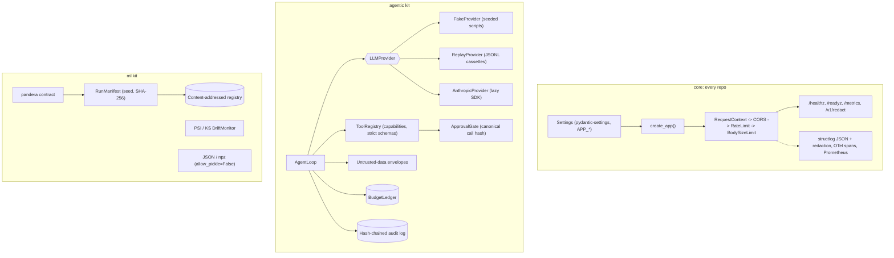

# progressive-model-delivery

The shared engineering baseline behind 20 small portfolio repositories: 10 agentic-AI
infrastructure projects and 10 ML projects. Each repo copies this template, keeps the kit it needs
and replaces the example content with its own pattern ([TEMPLATE_GUIDE.md](TEMPLATE_GUIDE.md)).
The template itself is a working Python 3.12 project whose tests, demo and benchmarks run offline
on a CPU-only machine without an API key.

It provides three things:

- **core** (every repo): typed settings, JSON logs with PII redaction, OpenTelemetry tracing,
  Prometheus metrics and a FastAPI app factory with health probes, API-key auth, rate limiting,
  body-size limits, security headers, strict CORS and non-leaking errors.
- **agentic kit**: an `LLMProvider` protocol (scripted `FakeProvider`, cassette `ReplayProvider`,
  `AnthropicProvider`), untrusted-data envelopes, a least-privilege tool registry, approvals bound
  to the exact call, persisted budgets and a hash-chained audit log with a verify CLI.
- **ml kit**: a pandera data contract, run manifests (seed, dataset SHA-256, package versions), a
  content-addressed model registry, PSI and KS drift monitors and pickle-free serialization.

## Architecture



Request path: `RequestContextMiddleware` assigns a request id, opens a server span, records metrics
by route template, adds security headers and turns any unhandled exception into a generic 500.
CORS admits only configured origins. `RateLimitMiddleware` verifies the API key (so invalid keys
share the caller's address bucket) and applies a token bucket. `BodySizeLimitMiddleware` rejects
declared or streamed bodies over the limit.

Agent step: the loop checks the step budget, sends a deterministic request (sorted tool specs,
envelope ids derived from content hashes), charges tokens and USD, then validates each tool call
against the registry. Calls with side-effect capabilities run only after a different principal
approves that exact canonical call; tool output goes back to the model inside an untrusted-data
envelope, and every decision is appended to the audit log.

Layout:

```text
src/progressive_model_delivery/   core/  agentic/  ml/  cli.py
tests/unit, tests/integration
bench/bench_baseline.py   scripts/check_baseline.py   tasks.py (Makefile delegates to it)
docs/THREAT_MODEL.md      docs/adr/   CLAIMS.md   MODEL_CARD.md   TEMPLATE_GUIDE.md
```

## Quickstart

Requirements: [uv](https://docs.astral.sh/uv/) and Python 3.12.

```bash
uv sync --frozen
uv run python tasks.py demo    # offline agentic and ML demos, JSON summaries on stdout
uv run python tasks.py check   # ruff, mypy --strict, pytest + coverage, bandit, pip-audit, baseline
uv run python tasks.py bench   # micro-benchmarks with regression thresholds
```

On Windows with a small repository drive, keep the environment elsewhere first:
`$env:UV_PROJECT_ENVIRONMENT = "C:/Users/<you>/.venvs/progressive-model-delivery"`.

Run the service:

```bash
uv run progressive-model-delivery generate-api-key          # prints a key and its SHA-256 digest
APP_API_KEY_SHA256=<digest> uv run progressive-model-delivery serve
curl -s http://127.0.0.1:8000/healthz
curl -s -H "X-API-Key: <key>" -H "Content-Type: application/json" \
     -d '{"text": "mail jane@example.com"}' http://127.0.0.1:8000/v1/redact
```

Verify an audit log: `uv run progressive-model-delivery audit verify var/demo/agentic/audit.jsonl`.

Containers: `docker compose up --build` runs the non-root, read-only image. Container build, smoke
test, trivy scan and SBOM generation are verified in CI (`.github/workflows/ci.yml`, job `docker`);
they were not run locally as part of building this template.

## Results

Measured with `uv run python tasks.py bench` (which runs `bench/bench_baseline.py --check`) on
2026-09-13: Windows 10 (10.0.19045), Intel64 Family 6 Model 158, 6 logical CPUs, Python 3.12.14.
Latency per call in microseconds. CI runs the same command against the looser limits in
`bench/thresholds.json`; this run printed "all benchmarks within thresholds".

| benchmark | runs | p50 (us) | p95 (us) |
|---|---:|---:|---:|
| redact_text_1kb | 2000 | 337.7 | 459.3 |
| rate_limiter_check | 20000 | 1.8 | 1.9 |
| llm_request_sha256_10_messages | 2000 | 97.6 | 120.4 |
| audit_append_fsync | 200 | 7751.2 | 9635.7 |
| audit_verify_1000_entries | 10 | 36007.2 | 38167.3 |
| drift_check_10k_vs_10k | 30 | 2583.9 | 3771.2 |

`audit_append_fsync` includes one `fsync` per entry, so it mostly measures the disk (an earlier run
on the same machine measured a p50 of 1164.1 us). `redact_text_1kb` rose from a p50 of 212.2 us
when URL-password, non-ASCII e-mail and linear-time matching were added to redaction. These are
single-machine numbers for spotting regressions, not performance claims.

## Security

Threats, controls and the tests that prove them are in [docs/THREAT_MODEL.md](docs/THREAT_MODEL.md);
every claim below links to evidence in [CLAIMS.md](CLAIMS.md).

- API keys are stored as SHA-256 digests and compared in constant time against every configured
  key; protected routes fail closed when no keys are configured.
- Errors return fixed codes and messages; exception text, tracebacks and submitted values stay out
  of responses. Logs, tracebacks and audit records pass through PII and secret redaction.
- Token-bucket rate limiting, request body limits, security headers (CSP, frame, referrer, HSTS,
  no-store) and CORS restricted to explicit origins without credentials.
- Prompt-injection containment does not rely on the model: a scripted model that always obeys
  injected instructions still cannot run a side-effect tool without a human approval bound to the
  exact arguments and to the requesting principal. Budgets cap steps, tokens and USD across
  restarts and across workers sharing a ledger, and billed failures are charged too.
- `AnthropicProvider` (default `claude-opus-5`, used only when `ANTHROPIC_API_KEY` is set) sends
  strict tool schemas (converted with the SDK's `transform_schema`), adaptive thinking and effort
  to the models documented for them, and the server-side refusal fallback (`fallbacks="default"`)
  to Claude Opus 5 and Fable 5.x. It streams requests above 16K `max_tokens`, echoes thinking
  blocks back unchanged, checks `stop_reason` including `refusal` before reading content, charges
  prompt-cache tokens and billed malformed responses to budgets, and maps SDK errors to typed,
  retry-aware exceptions.
- Artifacts are pickle-free; the registry verifies content hashes on load.
- CI: ruff, mypy --strict, pytest with an 85% coverage floor, bandit, semgrep with repo rules,
  pip-audit, gitleaks, hadolint, trivy image scan and a syft CycloneDX SBOM. Base images are
  pinned by digest. See [SECURITY.md](SECURITY.md) for reporting.

## Non-goals

- A library or framework: this is a copy-and-adapt template, not a package to depend on.
- Distributed rate limiting: buckets are per process; multi-replica deployments need a shared store.
- User identity: one API-key scheme; JWT/OIDC and key rotation belong to repos that need them.
- Exporting telemetry: traces go to the console or nowhere; OTLP export is left to each repo.
- Tamper-proof audit: the log is tamper-evident. An open writer notices truncation or rewriting at
  its next append, but detecting tail truncation after the fact needs a head hash stored
  elsewhere. The budget ledger and approval files are not tamper-evident (whoever can write them
  can reset spend or forge an approval), and one model call can overshoot the token or USD limit.
- Distributed locking: ledgers, approval stores and audit writers coordinate through local file
  locks, which assume a local filesystem rather than a network share.
- Complete PII detection: redaction is pattern-based and misses names, postal addresses and
  free-form identifiers.
- Injection-proof models: envelopes help the model separate data from instructions, but the
  guarantees come from the registry and approval gate.
- Live model evaluation: tests, demo and bench never call a paid API. `AnthropicProvider` is tested
  against a mocked client, and no recorded cassettes ship with the template.
- Signed model provenance or an MLflow server: the registry is a local content-addressed store.
- Exact small-sample KS p-values: the p-value uses the asymptotic distribution with Stephens'
  correction.
