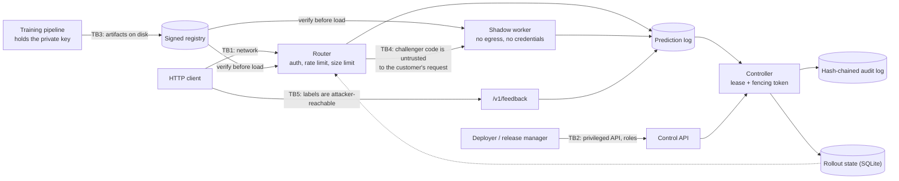

# Threat model

Method: STRIDE per trust boundary. Each row maps a threat to the control that addresses it and to
the test, bench script or CI job that proves the control works. `scripts/check_baseline.py` verifies
that every backticked evidence reference exists.

The system under analysis is a release control plane: it decides, from live evidence, whether a new
model gets customer traffic. That makes two things valuable to an attacker that a plain inference
service does not have: **the decision** (get a bad model promoted, or get a good one rolled back)
and **the evidence the decision is made from** (poison it and the decision follows). Most rows below
are about those two.

## System and trust boundaries

Assets: the promotion decision, the evidence it rests on (prediction log, labels, drift
references), the model artifacts and their provenance, the audit chain, API keys and the signing
key, and personal data in requests and logs.

Assumptions: TLS terminates in front of the services; the host and container runtime are trusted;
the training pipeline and its private signing key are outside this system and trusted; principals
are bound to authenticated API keys through `APP_ROLE_BINDINGS`.

## STRIDE table

### Spoofing

| ID | Threat | Entry point / asset | Control | Test / evidence | Residual risk |
|---|---|---|---|---|---|
| S1 | Caller guesses, replays or brute-forces an API key | TB1/TB2, protected routes | Keys stored as SHA-256 digests; every digest compared with no early exit; fail closed with no keys configured; uniform 401 | `tests/unit/test_security.py::test_every_configured_digest_is_compared_without_early_exit`, `tests/unit/test_security.py::test_no_configured_keys_fails_closed`, `tests/integration/test_app.py::test_protected_endpoint_requires_a_valid_api_key` | No expiry or rotation workflow; no per-user identity (OIDC) |
| S2 | Someone other than the router posts jobs to the shadow worker, e.g. to plant favourable shadow predictions | TB4, shadow worker | Shared forwarding token compared with `hmac.compare_digest` **before the body is parsed**; the worker is on a network with no gateway and publishes no port | `tests/integration/test_shadow_isolation.py::test_shadow_worker_authenticates_before_parsing_and_verifies_releases`, `scripts/compose_e2e.sh` | One shared token, not per-request signatures; rotation is a restart |
| S3 | A model artifact claims to be a release it is not | TB3, registry | Release id *is* the SHA-256 of the manifest; the file name must match it; the Ed25519 signature is over exactly those bytes and is checked against a trust store keyed by key id, not by a key carried in the manifest | `tests/integration/test_registry_release.py::test_tampered_manifest_is_rejected`, `tests/integration/test_registry_release.py::test_re_signed_manifest_under_the_new_hash_needs_a_trusted_key`, `tests/unit/test_registry_signing.py::test_unknown_keys_and_malformed_signatures_fail_closed` | Trust store is an environment variable; no revocation list |
| S4 | A second controller believes it is the leader and writes decisions | Rollout state | SQLite lease with a monotonic fencing token; every write re-checks the token inside the transaction, and the holder identity is per process, so two replicas of one `APP_CONTROLLER_ID` cannot both renew it | `tests/integration/test_controller.py::test_only_the_lease_holder_reconciles`, `tests/integration/test_controller.py::test_two_controllers_from_the_same_settings_do_not_both_hold_the_lease`, `tests/integration/test_controller.py::test_a_controller_that_lost_its_lease_cannot_write`, `tests/unit/test_control_store.py::test_an_expired_lease_is_taken_over_with_a_new_fencing_token` | Lease correctness depends on the SQLite file being a single shared file |

### Tampering

| ID | Threat | Entry point / asset | Control | Test / evidence | Residual risk |
|---|---|---|---|---|---|
| T1 | Model bytes are replaced with a different booster, or with a pickle payload | TB3, registry | Blob digests verified against the manifest before parsing; the artifact must look like LightGBM text; the parsed booster's feature names must equal the manifest's order; no pickle path anywhere | `tests/integration/test_registry_release.py::test_tampered_model_bytes_are_rejected_before_parsing`, `tests/integration/test_registry_release.py::test_publishing_refuses_anything_but_lightgbm_text`, `tests/unit/test_no_pickle.py::test_source_tree_has_no_pickle_family_serialization` | LightGBM's own text parser is trusted |
| T2 | A release's recorded metrics or data lineage are edited to make it look safe | TB3, manifest | Metrics, dataset digests, run manifest digest and model card digest are inside the signed manifest, so editing any of them invalidates the signature | `tests/integration/test_registry_release.py::test_lineage_and_reproducibility_are_pinned`, `tests/unit/test_ml_registry.py::test_tampered_version_record_is_detected` | Lineage is only as honest as the pipeline that wrote it |
| T3 | The rollout policy is quietly loosened (alpha raised, guardrail dropped) between proposal and decision | Rollout spec | The spec is parsed and hashed at proposal; the hash is stored with the rollout and written into every audit entry; unknown fields are refused rather than ignored | `tests/unit/test_control_spec.py::test_the_spec_hash_changes_with_every_field_that_affects_decisions`, `tests/unit/test_control_spec.py::test_extra_fields_are_refused_so_typos_never_pass_silently`, `tests/unit/test_control_rbac.py::test_an_approval_against_stale_evidence_is_refused` | A spec is only compared to itself; nothing prevents proposing a weak spec in the first place, which is what review is for |
| T4 | Rollout state is edited directly to skip stages or resurrect a rolled-back model | Rollout state | Lifecycle transitions are typed, so illegal edges are unrepresentable in code; stored states are rebuilt through `from_record`, which refuses impossible combinations; canary weights are a closed enumeration | `tests/unit/test_registry_lifecycle.py::test_random_action_sequences_only_ever_follow_legal_edges`, `tests/unit/test_registry_lifecycle.py::test_skipping_stages_or_leaving_terminal_states_is_illegal`, `tests/unit/test_control_store.py::test_an_impossible_stored_lifecycle_is_refused_on_read` | Direct SQLite write access is equivalent to control-plane access; protect the file |
| T5 | **Metric poisoning**: labels are submitted for requests that never happened, or many times for the same request, to move the guardrail the controller reads | TB5, `/v1/feedback` | A label is accepted only for a request id the router itself issued, only inside the maturation window, and only once; duplicates are collapsed again at read time; feedback has its own rate limit | `tests/integration/test_router.py::test_feedback_integrity`, `tests/integration/test_router.py::test_feedback_is_rate_limited_per_key`, `tests/unit/test_predlog.py::test_request_index_accepts_each_known_request_once_within_the_ttl`, `tests/integration/test_evidence.py::test_a_duplicate_label_row_in_another_segment_is_collapsed` | A caller who can *make* requests can label their own truthfully-issued request ids; that is indistinguishable from a real user and is bounded by rate limits, not prevented |
| T6 | Evidence is inflated with rows from another rollout, from the future, or from unmatured requests | Prediction log | The join filters on rollout id and on `ts <= cutoff`, and only counts requests whose label window has closed | `tests/integration/test_evidence.py::test_another_rollouts_rows_are_never_read`, `tests/integration/test_evidence.py::test_predictions_and_labels_from_the_future_are_invisible`, `tests/integration/test_evidence.py::test_a_request_younger_than_the_label_window_is_excluded` | Clock skew between router and controller shifts the cutoff |
| T7 | Traffic is steered so the challenger only ever sees easy requests | Assignment | The arm comes from a keyed hash of the subject id and the rollout salt, not from anything in the request body; without the HMAC secret an attacker cannot pick a subject id that lands on a chosen arm | `tests/unit/test_assignment.py::test_subject_hash_is_keyed_and_validated`, `tests/unit/test_assignment.py::test_split_stays_within_binomial_bounds` | A caller who controls many subject ids still shapes the *population* on both arms; subgroup guardrails, not assignment, catch that |
| T8 | Compromised dependency, base image or CI action | Build pipeline | `uv.lock` with hashes; pip-audit; base images pinned by digest; trivy; CycloneDX SBOM; Dependabot | `.github/workflows/ci.yml#pip-audit`, `.github/workflows/ci.yml#docker` | Actions are tag-pinned until SHA pinning at publish time |

### Repudiation

| ID | Threat | Entry point / asset | Control | Test / evidence | Residual risk |
|---|---|---|---|---|---|
| R1 | "Nobody approved that promotion" / "the controller rolled it back for no reason" | Audit chain | Every proposal, approval, refusal-worthy state, rollback and override is an entry in a hash-chained log, and controller decisions carry the full evidence: each e-value, its threshold, sample counts, the exposure the decision was made under, drift statistics and the spec hash | `tests/unit/test_control_store.py::test_the_audit_chain_links_every_entry_to_its_predecessor`, `tests/integration/test_controller.py::test_a_pipeline_bug_challenger_is_rolled_back_with_evidence_in_the_audit_log`, `tests/integration/test_demo.py::test_the_audit_chain_records_and_verifies_the_whole_run` | Principal identity is an API key digest, not a signed human identity |
| R2 | The audit log is edited or truncated to hide a decision | Audit chain | Each entry hashes its predecessor, so editing any entry breaks verification; truncation is detectable against a head recorded elsewhere, which `audit --export` produces | `tests/unit/test_control_store.py::test_tampering_with_the_audit_log_is_detected`, `tests/unit/test_control_store.py::test_truncating_the_tail_is_only_detectable_against_a_known_head`, `tests/unit/test_control_rbac.py::test_the_audit_chain_survives_every_rbac_path` | The chain is not anchored anywhere external; export the head off-box to make truncation detectable |
| R3 | A decision cannot be reproduced afterwards | Audit chain, logs | A reconciliation pass is a pure function of state, logs and clock; a replay on a copy of the state reproduces every decision and the same audit hashes | `tests/integration/test_controller.py::test_replaying_a_rollout_on_a_copy_of_the_state_reproduces_every_decision`, `tests/integration/test_controller.py::test_reconciling_twice_at_the_same_clock_changes_nothing_the_second_time` | Replay needs the prediction log, which has its own retention |

### Information disclosure

| ID | Threat | Entry point / asset | Control | Test / evidence | Residual risk |
|---|---|---|---|---|---|
| I1 | Raw customer identifiers land in the prediction log, the audit log or traces | Logs, prediction log | Subject ids are HMAC-hashed before assignment and before anything is written; only the hash appears in a record | `tests/unit/test_assignment.py::test_subject_hash_is_keyed_and_validated`, `tests/integration/test_router.py::test_champion_only_serving_logs_hashed_subjects` | Feature values themselves are logged, because the drift monitor needs them; treat the log as sensitive |
| I2 | PII or secrets written to logs, traces or audit records | Logs, audit log | Redacting structlog and stdlib processor (after traceback formatting); audit data redacted before hashing; hex digests and UUIDs exempt from card matching | `tests/unit/test_logging.py::test_exception_tracebacks_are_redacted`, `tests/unit/test_redaction.py::test_credentials_embedded_in_urls_are_redacted`, `tests/unit/test_redaction.py::test_hex_digests_and_uuids_are_not_mistaken_for_card_numbers` | Pattern-based: names, addresses and free-form identifiers are not detected |
| I3 | Error bodies leak exception text, file paths or submitted feature values | TB1, responses | Fixed error codes and messages; validation details without input; readiness reports check names only | `tests/integration/test_router.py::test_input_contract_rejects_bad_requests_without_echoing_them`, `tests/integration/test_app.py::test_unhandled_exceptions_become_generic_500s`, `tests/integration/test_app.py::test_readyz_reports_check_names_without_error_details` | None known |
| I4 | Metrics leak a rollout's standing to anyone who can scrape | `/metrics` | Metrics require an API key by default; labels are release short ids and route templates, never raw ids or paths | `tests/integration/test_app.py::test_metrics_require_auth_and_label_route_templates` | Operators may disable auth for scraping; restrict by network then |
| I5 | The shadow worker exfiltrates the traffic it sees | TB4 | The worker sits on a network declared `internal: true`, so it has no route off the bridge; it holds no credentials with side effects and writes only to the prediction log | `scripts/compose_e2e.sh`, `.github/workflows/ci.yml#compose-e2e` | A challenger could still encode information into its *scores*, which are logged by design |
| I6 | Secrets committed to the repository | Git history | Only `.env.example` committed; `.env` ignored; gitleaks and the semgrep secrets pack in CI | `.github/workflows/ci.yml#gitleaks`, `.github/workflows/ci.yml#semgrep` | Scanners miss unusual secret formats |
| I7 | Cross-origin pages read control-plane responses | Browsers | Explicit origin list, no credentials, `*` refused by config validation; strict security headers | `tests/integration/test_app.py::test_cors_allows_only_configured_origins`, `tests/unit/test_config.py::test_wildcard_or_malformed_origins_are_rejected` | None known |

### Denial of service

| ID | Threat | Entry point / asset | Control | Test / evidence | Residual risk |
|---|---|---|---|---|---|
| D1 | Request floods on the router or the control API | TB1/TB2 | Token bucket per verified key or per client address (IPv6 by /64); invalid keys share the address bucket; probes exempt | `tests/integration/test_app.py::test_rate_limit_rejects_bursts_and_exempts_probes`, `tests/integration/test_app.py::test_invalid_keys_cannot_mint_fresh_rate_limit_buckets`, `tests/unit/test_ratelimit.py::test_admissions_never_exceed_the_token_bucket_bound` | In-process only; behind a proxy all clients share one address unless proxy headers are trusted |
| D2 | Oversized or endless request bodies | TB1 | Content-Length check plus streaming byte count; malformed lengths get 413, not a 500 | `tests/integration/test_app.py::test_body_size_limit_applies_to_declared_and_streamed_bodies`, `tests/unit/test_middleware.py::test_malformed_content_length_is_rejected_instead_of_crashing` | Slow-loris is left to the ASGI server and proxy timeouts |
| D3 | **A slow, hanging or crashing challenger takes the customer's request down with it** | TB4, request path | The champion answers first; the shadow hop is a non-blocking `put_nowait` on a bounded queue (p99 1.9 us) that drops and counts when full; delivery has a hard timeout and never raises into the request | `tests/integration/test_shadow_isolation.py::test_shadow_faults_never_affect_champion_responses`, `tests/integration/test_shadow_isolation.py::test_a_hanging_shadow_worker_does_not_slow_the_champion`, `tests/unit/test_forwarder.py::test_a_full_queue_drops_without_blocking`, `bench/bench_serving.py` | A shadow worker sharing a CPU with the router still competes for it; give it its own container and CPU share (see the serving bench) |
| D4 | A flood of feedback drowns the label path or the log | TB5 | Feedback has its own token bucket, separate from prediction traffic; the request index is bounded and TTL-evicted | `tests/integration/test_router.py::test_feedback_is_rate_limited_per_key`, `tests/unit/test_predlog.py::test_request_index_accepts_each_known_request_once_within_the_ttl` | Index eviction under extreme churn refuses otherwise-valid late labels |
| D5 | A rollout that can never meet its gate blocks the pipeline forever | Controller | Every stage has a maximum duration; a stage that has not met its gate by then aborts the rollout instead of holding | `tests/unit/test_control_guardrails.py::test_a_stage_that_never_meets_its_gate_aborts_after_its_maximum_duration` | An aborted rollout needs a human to decide what to do next |
| D6 | Crafted text makes redaction backtrack quadratically | Redaction | Patterns anchor at run starts (lookbehinds) and use bounded quantifiers | `tests/unit/test_redaction.py::test_redaction_stays_fast_on_adversarial_input`, `bench/bench_baseline.py` | New regex-heavy code needs the same review |
| D7 | Container exhausts host resources | Runtime | Compose memory, CPU and PID limits; read-only root filesystem | `.github/workflows/ci.yml#docker` | Limits are deployment-specific |

### Elevation of privilege

| ID | Threat | Entry point / asset | Control | Test / evidence | Residual risk |
|---|---|---|---|---|---|
| E1 | A deployer promotes their own model to production | TB2, promotion decision | Final promotion needs a release manager who is **not** the proposer; a deployer cannot approve at all | `tests/unit/test_control_rbac.py::test_the_proposer_cannot_approve_and_a_deployer_cannot_approve_at_all`, `tests/unit/test_control_rbac.py::test_only_a_release_manager_bootstraps_and_only_a_deployer_proposes` | Role bindings are API keys; one person holding two keys defeats this, which is an operational control |
| E2 | A single operator forces a stage past its statistical gate | TB2, override path | Overrides execute only once two *distinct* release managers have signed; the requester counts as the first signature; the override expires if the rollout moved on | `tests/unit/test_control_rbac.py::test_an_override_needs_two_distinct_release_managers`, `tests/unit/test_control_rbac.py::test_a_release_manager_requesting_an_override_counts_as_the_first_signature`, `tests/unit/test_control_rbac.py::test_an_override_expires_when_the_rollout_moves_on` | Same two-keys-one-person caveat |
| E3 | An attacker with read-only access stops a rollout, or starts one | TB2 | Viewer role can read rollouts, evidence and the audit chain and nothing else; rollback and proposal are role-checked | `tests/unit/test_control_rbac.py::test_a_viewer_cannot_roll_back`, `tests/unit/test_control_rbac.py::test_override_requests_are_validated_and_role_checked` | None known |
| E4 | Deserializing an attacker-controlled artifact runs code | TB3 | No pickle, joblib, dill, cloudpickle or pandas pickle I/O; semgrep rules and the baseline check; npz `allow_pickle=False` | `tests/unit/test_no_pickle.py::test_source_tree_has_no_pickle_family_serialization`, `tests/integration/test_check_baseline.py::test_pickle_family_serialization_in_source_fails`, `.github/workflows/ci.yml#semgrep` | Third-party libraries may deserialize unsafely on their own paths |
| E5 | Code execution inside a container escalates to the host | Runtime | Non-root UID 10001; read-only root filesystem; all capabilities dropped; no-new-privileges | `.github/workflows/ci.yml#docker` | Kernel or runtime vulnerabilities |
| E6 | A challenger whose signature stops verifying mid-rollout keeps serving | TB3, router and controller | The router verifies before every load of a model it has not seen and keeps serving the champion if verification fails; the controller refuses to reconcile a rollout whose challenger no longer verifies | `tests/integration/test_router.py::test_an_unverifiable_challenger_leaves_the_champion_serving`, `tests/integration/test_controller.py::test_the_controller_refuses_a_challenger_whose_signature_stopped_verifying` | A model already loaded in memory stays loaded until the process restarts |

## Statistical threats

These are not STRIDE rows but they are the failure modes most likely to actually cost money here.

| ID | Threat | Control | Evidence | Residual risk |
|---|---|---|---|---|
| ST1 | A false rollback rate inflated by monitoring every pass ("peeking") | Every guardrail is an e-value or a mixture SPRT, valid under any stopping rule; measured A/A rollback rate 0.6% against a 2.5% budget, versus 36.7% for a repeatedly-read z-test | `bench/bench_validity.py`, `tests/unit/test_stats_evalues.py::test_continuous_monitoring_keeps_false_rejections_below_alpha` | The mean-difference tests are asymptotically valid (plug-in variance), not exactly; a burn-in covers the skew |
| ST2 | A model that is worse only for one subgroup passes a global guardrail | A worst-subgroup error guardrail with `alpha_rollback` split Bonferroni-style over subgroups, evaluated from the shadow stage onwards | `tests/unit/test_control_guardrails.py::test_only_the_named_subgroup_reacts_to_a_subgroup_regression`, `bench/bench_power.py` | Only the subgroups in the data contract are watched (here: region); an unmodelled subgroup is invisible |
| ST3 | A verdict reached on traffic the model was never trained for | A PSI drift precondition on features gates advancement; the rollout holds instead of advancing | `tests/integration/test_controller.py::test_a_covariate_shift_stops_the_rollout_from_advancing` | PSI thresholds are conventional (0.2/0.25), not derived |
| ST4 | A regression that shows up in scores long before any label matures | A label-free score-PSI guard can roll a rollout back on its own | `tests/unit/test_control_guardrails.py::test_the_label_free_score_guard_rolls_back_on_its_own`, `tests/integration/test_evidence.py::test_the_score_guard_fires_when_outputs_move_while_inputs_do_not` | A score shift is not proof of harm; this guard trades precision for speed |
| ST5 | Judging a rollout on the labels that happen to have arrived (survivorship) | Only requests whose maturation window has closed enter the tests; late labels are refused and counted, not imputed | `tests/integration/test_evidence.py::test_a_request_younger_than_the_label_window_is_excluded`, `tests/integration/test_demo.py::test_delayed_labels_really_were_delayed_and_some_were_lost` | Label loss that correlates with the outcome still biases the estimate; nothing here detects that |

## Out of scope

Network-level attacks below TLS; multi-tenant isolation; key management (the signing private key is
a file, the trust store an environment variable); denial of service beyond a single process;
multi-instance router deployments (see `docs/adr/0003-single-router-and-the-multi-instance-design.md`);
and anything about whether the model is *ethically* fit to deploy -- the subgroup guardrail catches
a regression against the previous model, which is not the same as fairness. The README Non-goals
section lists the rest.
