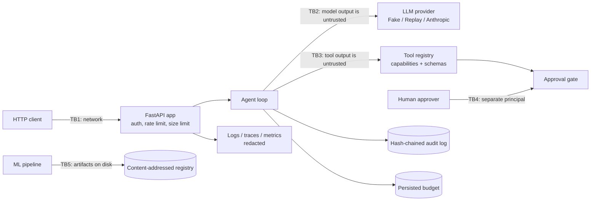

# Threat model

Method: STRIDE per trust boundary. Each row maps a threat to the control that addresses it and
to the test, bench script or CI job that proves the control works. `scripts/check_baseline.py`
verifies that every backticked evidence reference exists.

This file is the **template** threat model: it covers the shared baseline. Repos keep the rows
for the kit they use, delete the others, and add rows for their primary pattern (for example,
fencing tokens in the durable runtime, or the aggregate-norm bound in federated aggregation).

## System and trust boundaries

Assets: API keys and provider credentials, personal data in requests and logs, the integrity of
side effects performed by tools, spend (tokens and USD), audit evidence, and model artifacts.

Assumptions: TLS terminates in front of the service; the host and container runtime are trusted;
principals passed to the approval store are bound to authenticated identities by the repo.

## STRIDE table

| ID | STRIDE | Threat | Entry point / asset | Control | Test / evidence | Residual risk |
|---|---|---|---|---|---|---|
| S1 | Spoofing | Caller guesses, replays or brute-forces an API key | TB1, protected routes | Keys stored as SHA-256 digests; constant-time compare against every digest; fail closed with no keys; uniform 401 | `tests/unit/test_security.py::test_every_configured_digest_is_compared_without_early_exit`, `tests/integration/test_app.py::test_protected_endpoint_requires_a_valid_api_key` | No expiry or rotation workflow; per-user identity (JWT, OIDC) is repo-specific |
| T3 | Tampering | Model artifact swapped or replaced with a pickle payload | TB5, registry | Content-addressed blobs and records verified on load; npz with `allow_pickle=False`; pickle-family imports banned | `tests/unit/test_ml_registry.py::test_tampered_blob_is_detected`, `tests/unit/test_ml_serialization.py::test_pickled_npz_files_are_refused_on_load`, `tests/unit/test_no_pickle.py::test_source_tree_has_no_pickle_family_serialization` | Registry records are not signed; repos that need provenance add signatures (for example Ed25519) |
| T4 | Tampering | Compromised dependency, base image or CI action | Build pipeline | uv.lock with hashes; pip-audit; base images pinned by digest; trivy scan; CycloneDX SBOM; Dependabot | `.github/workflows/ci.yml#pip-audit`, `.github/workflows/ci.yml#docker` | Actions are tag-pinned until SHA pinning at publish time |
| I1 | Information disclosure | PII or secrets written to logs, traces or audit records | Logs, audit log | structlog and stdlib redaction processor (runs after traceback formatting); non-JSON values (sets, bytes, objects) become redacted text before rendering; mapping keys are scanned, and keys containing words such as password or secret are replaced wherever the word appears; quoted JSON pairs (whole quoted values), passwords in URLs, prefixed names such as DB_PASSWORD or aws_secret_access_key and non-ASCII e-mail addresses are matched; audit data redacted before hashing, with hex digests and UUIDs exempt from card matching | `tests/unit/test_logging.py::test_exception_tracebacks_are_redacted`, `tests/unit/test_redaction.py::test_quoted_short_and_escaped_secret_values_are_redacted_completely`, `tests/unit/test_redaction.py::test_credentials_embedded_in_urls_are_redacted`, `tests/unit/test_redaction.py::test_secret_words_make_a_key_sensitive_wherever_they_appear`, `tests/unit/test_redaction.py::test_non_ascii_email_addresses_are_redacted`, `tests/unit/test_logging.py::test_sets_bytes_objects_and_mapping_keys_are_redacted_before_rendering`, `tests/unit/test_redaction.py::test_any_email_address_is_redacted`, `tests/unit/test_redaction.py::test_quoted_prefixed_and_embedded_secrets_are_redacted`, `tests/unit/test_redaction.py::test_hex_digests_and_uuids_are_not_mistaken_for_card_numbers` | Pattern-based: names, postal addresses and free-form identifiers are not detected |
| I2 | Information disclosure | Error bodies leak exception text, file paths or submitted values | TB1, responses | Fixed error codes and messages; validation details without input; readiness reports names only | `tests/integration/test_app.py::test_unhandled_exceptions_become_generic_500s`, `tests/integration/test_app.py::test_validation_errors_never_echo_submitted_values`, `tests/integration/test_app.py::test_readyz_reports_check_names_without_error_details` | None known |
| I3 | Information disclosure | Metrics expose raw paths or IDs; metrics readable by anyone | `/metrics` | Route-template labels; metrics require an API key by default | `tests/integration/test_app.py::test_metrics_require_auth_and_label_route_templates` | Operators may disable auth for scraping; restrict by network then |
| I4 | Information disclosure | Secrets committed to the repository | Git history | Only `.env.example` committed; `.env` ignored; gitleaks and semgrep secrets pack in CI | `.github/workflows/ci.yml#gitleaks`, `.github/workflows/ci.yml#semgrep` | Scanners miss unusual secret formats |
| I5 | Information disclosure | Cross-origin pages read API responses | Browsers | Explicit origin list, no credentials, `*` refused by config validation; strict security headers | `tests/integration/test_app.py::test_cors_allows_only_configured_origins`, `tests/unit/test_config.py::test_wildcard_or_malformed_origins_are_rejected` | None known |
| I6 | Information disclosure | Contract violations or tool failures copy sensitive values into errors | ML contracts, agent loop | Contract errors summarize column/check/count only; tool failures reach the model as a generic message | `tests/unit/test_ml_contracts.py::test_violations_are_summarized_without_the_offending_values` | None known |
| D1 | Denial of service | Request floods | TB1 | Token bucket per verified key or per client address (IPv6 grouped by /64, IPv4-mapped addresses by their IPv4 address); invalid keys share the address bucket; probes exempt | `tests/integration/test_app.py::test_rate_limit_rejects_bursts_and_exempts_probes`, `tests/integration/test_app.py::test_invalid_keys_cannot_mint_fresh_rate_limit_buckets`, `tests/unit/test_middleware.py::test_ipv6_clients_are_limited_per_64_prefix` | In-process only; behind a proxy all clients share one address unless proxy headers are trusted; LRU eviction resets buckets under heavy key churn |
| D2 | Denial of service | Oversized or endless request bodies | TB1 | Content-Length check (ASCII digits only, so malformed values get 413 instead of a 500) plus streaming byte count | `tests/integration/test_app.py::test_body_size_limit_applies_to_declared_and_streamed_bodies`, `tests/unit/test_middleware.py::test_malformed_content_length_is_rejected_instead_of_crashing` | Slow-loris style attacks are left to the ASGI server and proxy timeouts |
| D5 | Denial of service | Crafted text makes redaction backtrack quadratically (logs and `/v1/redact` carry attacker-controlled text) | Redaction | Patterns start only at the beginning of a run (lookbehinds) and use possessive or RFC-bounded quantifiers | `tests/unit/test_redaction.py::test_redaction_stays_fast_on_adversarial_input`, `bench/bench_baseline.py` | Other regex-heavy code a repo adds needs the same review |
| D4 | Denial of service | Container exhausts host resources | Runtime | Compose memory, CPU and PID limits | `.github/workflows/ci.yml#docker` | Limits are deployment-specific |
| E3 | Elevation of privilege | Code execution inside the container escalates | Runtime | Non-root UID 10001; read-only root filesystem; all capabilities dropped; no-new-privileges | `.github/workflows/ci.yml#docker` | Kernel or runtime vulnerabilities |
| E4 | Elevation of privilege | Deserialization of attacker-controlled artifacts runs code | TB5 | No pickle, joblib, dill, cloudpickle or pandas pickle I/O; semgrep rules and the baseline check; npz `allow_pickle=False` | `tests/unit/test_no_pickle.py::test_source_tree_has_no_pickle_family_serialization`, `tests/integration/test_check_baseline.py::test_pickle_family_serialization_in_source_fails`, `.github/workflows/ci.yml#semgrep` | Third-party libraries may deserialize unsafely on their own paths |

Repudiation threats specific to this project are added with the rollout controller.

## Out of scope for the template

Network-level attacks below TLS, multi-tenant isolation, key management services, and denial of
service beyond a single process. Repos state their own out-of-scope items in their README
Non-goals section.
